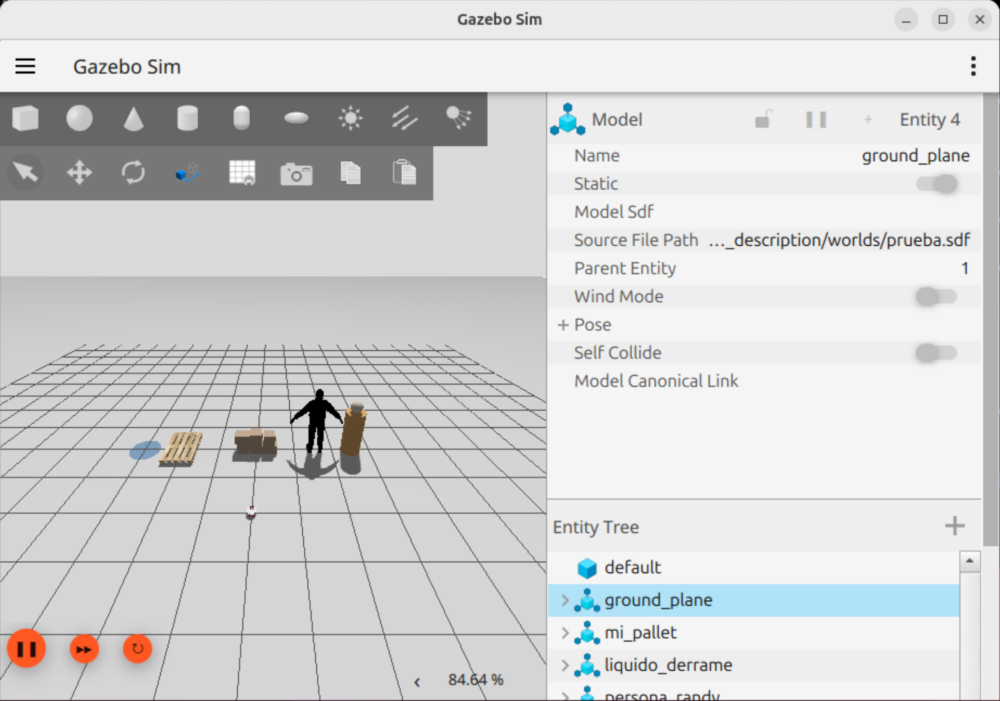
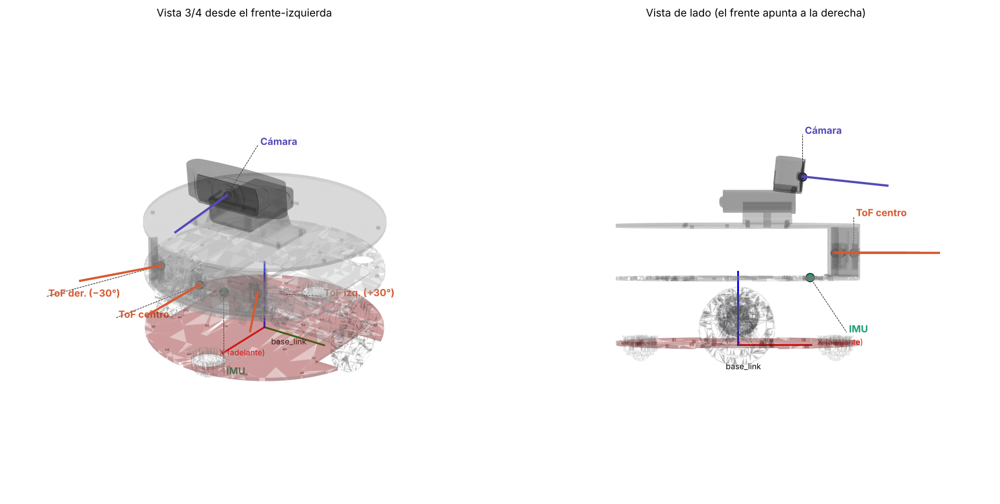

# Proyecto final
**Autores:** 
- Elena Sofía Luna Palacio
- Luis Gerardo Godfrey Castañeda
- Tania Ariadna Dominguez Palma

## Teleoperación con joystick comercial Turtlesim 
### Descripción breve
En esta actividad se implementó la comunicación entre un control de videojuego y ROS 2 mediante el paquete `joy`. Se desarrolló un nodo controlador que procesa las lecturas analógicas del joystick para convertirlas en comandos de velocidad (`geometry_msgs/msg/Twist`) y operar el simulador **Turtlesim**. Finalmente, se creó un archivo *launch* para automatizar el inicio de todos los nodos del sistema.

### Funcionamiento
- **Tópicos utilizados:** 
  - `/joy`: Recibe el estado del control mediante el mensaje `sensor_msgs/msg/Joy`. Utilizamos el arreglo de AXES, específicamente los índices 3 y 4 para los ejes X y Y del joystick elegido.
  - `/turtle1/cmd_vel`: Publica comandos de movimiento a la tortuga mediante el mensaje `geometry_msgs/msg/Twist`.

- **Nodos involucrados:**
  - `joy_node`: Captura los eventos del joystick comercial y los publica en `/joy`.
  - `play_station_turtle_controller`: Escucha el tópico `/joy`, extrae los valores de los ejes analógicos (`axes[3]` y `axes[4]`), los escala e interpreta para generar velocidades lineales y angulares, y los publica en `/turtle1/cmd_vel`.
  - `turtlesim_node`: Nodo de simulación gráfica que recibe las velocidades y mueve la tortuga.

### Comandos utilizados
Para ejecutar el proyecto desde una terminal
```bash
ros2 launch colmibotbasics play_station_turtle_controller.launch.py
```

### Problemas encontrados
**Problema**: La computadora no reconocía el control de Play Station.

**Solucion**: Cambiar de cable mini usb. Identificar uno que fuera de datos, no solo de carga.

### Video de funcionamiento
https://drive.google.com/file/d/1xeWZEY9VAiEY9kjB-hVeuJiEwnarTBqq/view?usp=sharing

## Gemelo Digital Colmibot
### Descripción breve
En esta actividad se creó un gemelo digital del colmibot basado en el diseño de CAD y se integró con ROS2 para poder visualizarlo con Rviz (una herramienta de visualización 3D). Para ello se convirtieron las piezas y sus "mates" en 15 links y 12 joints de URDF (código XML que define al robot).

### Herramientas
- SolidWorks: para procesar el diseño de CAD original
- STL y DAE: la geometría de las piezas
- sw2robot: exportador de SolidWorks para la creación de las mallas
- URDF: los componentes del robot y las relaciones entre estos
- ROS2 Jazzy: creación del modelo del robot
  + `joint_state_publisher`: nodo que permite modificar manualmente el valor de los *joints* (específicamente las de las ruedas) a través de una GUI u luego las publica en el tópico `/joint_states`.
  + `robot_state_publisher`: nodo encargado de calcular y publicar la posición de los componentes del robot a través del tópico `/tf_static`. Utiliza la información recibida en el tópico `/joint_states` para calcular transformaciones de los componentes y las publica en el tópico `/tf`. Además, este nodo publica la descripción del robot (URDF) a través del tópico `/robot_description`.
  + `rviz2`: permite mostrar el robot de forma gráfica.
    
### Implementación
Con base en los diseños de CAD se utilizó sw2robot para exportar los componentes al formato URDf. Así, se generaron los archivos STL que guardan la geometría de las piezas del robot. El archivo generado `robot_description.urdf` esta conformado por 15 *links* (la estructura física del robot) y 14 *joints* (las relaciones entre los componentes), de los cuales 12 son de tipo *fixed* i.e. una conexión rígida, y 2, las llantas, son de tipo *continuous* i.e. permiten una rotación sin límites del ángulo. Además, este archivo contiene las características físicas de los componentes y la referencia a su *mesh* (su archivo STL) y se utiliza como elemento raíz (sistema de referencia) a `base_link` (CLM_Base_2 en SolidWorks). 

Posteriormente se creó el archivo `display.launch.py` el cual llama de forma automática a los tres nodos: `joint_state_publisher`, `robot_state_publisher` y `rviz2`.

### Comandos para ejecución
Primero para descargar paquetes y dependencias:
```
sudo apt update
sudo apt install ros-jazzy-robot-state-publisher \
                 ros-jazzy-joint-state-publisher-gui \
                 ros-jazzy-rviz2 \
```
Para compilar el paquete robot_description:
```
source /opt/ros/jazzy/setup.bash
colcon build --symlink-install --packages-select robot_description
```
Para cargar el workspace:
```
source install/setup.bash
```
Y, por último, para ejecutar el modelo de ROS2:
```
ros2 launch robot_description display.launch.py
```
Si aparece vacía la visualización, usar el siguiente comando:
```
LIBGL_ALWAYS_SOFTWARE=1 ros2 launch robot_description display.launch.py
```

### Problemas, soluciones y limitaciones
- Como SolidWorks no es nativo de MacOS, primero se intentó crear el archivo URDF desde CAD Oneshape. Sin embargo, una limitación de este es que los *mates* no se importan directamente. Por lo tanto, se decidió usar una máquina con Windows y SolidWorks.
- Una simplificación que se le hizo al robot fue mantener todos los elementos fijos excepto por las dos ruedas principales. Esto inlcuye a las "ruedas locas" para poder enforcarnos en un solo tipo de movimiento.
- Se buscó solo representar la geometría del robot, no necesariamente cómo se movería y su relación con el motor (un desplazamiento físico).
- Se quitaron muchos de los elementos electrónicos que para la visualización no eran necesarios, dejando solo la estuctura general.

### Link al video
https://itam2-my.sharepoint.com/personal/tania_dominguez_itam_mx/_layouts/15/stream.aspx?id=%2Fpersonal%2Ftania%5Fdominguez%5Fitam%5Fmx%2FDocuments%2F1%20ITAM%2F11vo%20semestre%2FSeminario%20de%20Titulaci%C3%B3n%2FactividadROSSolid%2FVideoROS%2DSolid%2Emp4&ga=1&referrer=StreamWebApp%2EWeb&referrerScenario=AddressBarCopied%2Eview%2E2aafc7c3%2Df40c%2D48a9%2Da409%2Da97c622bbd1a


## Integración del Colmibot en Gazebo
### Descripción breve
En esta actividad se integró el modelo del Colmibot (paquete `robot_description`) en **Gazebo Harmonic**, un simulador con física (gravedad, fricción, colisiones), para poder moverlo como un robot diferencial. El robot se controla con el mismo joystick comercial y el mismo nodo de la actividad de Turtlesim, conectando sus comandos de velocidad con la simulación mediante `ros_gz_bridge`.

Un mismo archivo URDF sirve para visualizar y para simular: `robot_state_publisher` lo lee y lo publica en el tópico `/robot_description`, junto con la posición de cada pieza en `/tf`. RViz toma esa información para **visualizar** el robot y Gazebo la toma para **simularlo con física**. Las etiquetas `<gazebo>` que se agregaron al final del URDF solo las interpreta Gazebo; RViz las ignora.

### Herramientas
- **Gazebo Harmonic**: simulador de física compatible con ROS 2 Jazzy.
- **ros_gz_sim**: abre Gazebo y crea (*spawn*) el robot en el mundo a partir del URDF.
- **ros_gz_bridge**: puente que traduce tópicos entre ROS 2 y Gazebo, ya que usan sistemas de mensajes distintos.
- **Plugin DiffDrive** (`gz-sim-diff-drive-system`): convierte comandos de velocidad (`Twist`) en el giro de cada llanta.
- **Plugin JointStatePublisher** (`gz-sim-joint-state-publisher-system`): publica el ángulo de las llantas.
- **joy**: lee el control y publica su estado en `/joy`.
- **colmibotbasics**: nuestro nodo de la actividad de Turtlesim, reutilizado sin cambios en su lógica.

### Modificaciones al modelo
Todas se hicieron sobre `robot_description.urdf`.

#### 1. Eje de giro de las llantas
En los dos *joints* `continuous` se cambió `<axis xyz="1 0 0"/>` por `<axis xyz="-1 0 0"/>`.

`<axis>` define alrededor de qué línea gira la llanta y hacia qué lado es el giro positivo, según la **regla de la mano derecha** (el pulgar apunta en la dirección del eje y los dedos indican el sentido positivo). En ROS el robot usa la convención **x hacia adelante, y hacia la izquierda, z hacia arriba**, por lo que para avanzar las llantas deben girar en positivo alrededor de un eje que apunte a la izquierda (+y).

Al calcular la orientación de los ejes exportados desde SolidWorks, ambos apuntaban hacia la derecha (-y). Como el plugin DiffDrive envía velocidad positiva a ambas llantas para avanzar, el robot se movía en reversa. Al invertir el eje, una velocidad positiva hace avanzar al robot. En RViz el único efecto es que el slider gira la llanta en sentido contrario.

#### 2. Fricción
```xml
<gazebo reference="CLM_Llanta60mmD_1"><mu1>1.0</mu1><mu2>1.0</mu2></gazebo>
<gazebo reference="CLM_RuedaLoca_1"><mu1>0.0</mu1><mu2>0.0</mu2></gazebo>
```
`reference` indica la pieza a la que se aplica y `mu1`/`mu2` son los coeficientes de fricción en dos direcciones.
- **Llantas (1.0)**: tienen agarre con el piso; sin fricción patinarían en su lugar.
- **Ruedas locas (0.0)**: en el modelo son fijas (no giran), por lo que con fricción arrastrarían y frenarían al robot. Con fricción cero se deslizan y se comportan como una rueda loca de bola, que rueda en cualquier dirección.

#### 3. Plugin DiffDrive (motor virtual)
Convierte una orden de "avanza a X m/s y gira a Y rad/s" en la velocidad de cada llanta. Con el radio y la separación de las llantas calcula cuánto debe girar cada una: si ambas giran igual el robot avanza recto, y si una gira más rápido que la otra el robot da vuelta.

| Parámetro | Valor | Significado |
|---|---|---|
| `left_joint` / `right_joint` | joints de `CLM_Llanta60mmD_1` / `CLM_Llanta60mmD_2` | Uniones de la llanta izquierda y derecha |
| `wheel_radius` | 0.03 m | Radio de la llanta (60 mm de diámetro) |
| `wheel_separation` | 0.174 m | Distancia entre llantas, medida del CAD |
| `max_linear_velocity` | 0.5 m/s | Límite de avance; el nodo del joystick puede pedir hasta 2 m/s, excesivo para un robot de 20 cm |
| `max_angular_velocity` | 3.0 rad/s | Límite de giro |
| `topic` | `/cmd_vel` | Tópico donde recibe las órdenes de velocidad |
| `odom_topic` | `/odom` | Tópico donde publica la posición estimada del robot |
| `tf_topic`, `frame_id`, `child_frame_id` | `/tf`, `odom`, `base_link` | Publica la transformada `odom → base_link`: dónde está el robot respecto a su punto de partida |

#### 4. Plugin JointStatePublisher
Publica en `/joint_states` cuánto ha girado cada llanta dentro de Gazebo; es lo mismo que hacían los sliders en RViz, pero ahora lo calcula la simulación. Así `robot_state_publisher` conoce el ángulo real de las llantas, lo que permite, por ejemplo, ver el robot en RViz y Gazebo al mismo tiempo.

#### 5. Masas
Se usan las masas e inercias reales exportadas desde el CAD actualizado (aprox. 2.27 kg en total).

#### Archivos agregados
- `config/gz_bridge.yaml`: tópicos que traduce el puente y su dirección.
- `launch/gazebo.launch.py`: arranca todo el sistema.
- Dependencias en `package.xml` (`ros_gz_sim`, `ros_gz_bridge`, `joy`, `colmibotbasics`) y la carpeta `config` en `CMakeLists.txt`.

#### La carpeta `config` y su instalación
`config` es una carpeta nueva para los **archivos de configuración** del paquete (es una convención de ROS). Contiene `gz_bridge.yaml`, la lista de tópicos que el puente traduce entre ROS 2 y Gazebo y en qué dirección.

ROS no usa los archivos de `src/` directamente, sino la copia que `colcon build` deja en `install/`. La siguiente línea de `CMakeLists.txt` indica qué carpetas se copian:
```cmake
install(DIRECTORY urdf meshes launch rviz config
  DESTINATION share/${PROJECT_NAME})
```
```
src/robot_description/              install/robot_description/share/robot_description/
├── urdf/        ──── se copia ───→ ├── urdf/
├── meshes/      ──── se copia ───→ ├── meshes/
├── launch/      ──── se copia ───→ ├── launch/
├── rviz/        ──── se copia ───→ ├── rviz/
└── config/      ──── se copia ───→ └── config/
```
El launch busca el archivo en `install/.../config/gz_bridge.yaml`, por lo que si `config` no está en esa lista el puente no encuentra su configuración. **Regla:** cada carpeta nueva del paquete debe agregarse a esa línea de `CMakeLists.txt` y después recompilar.

### Arquitectura de comunicación
```
Control PS → joy_node → /joy → play_station_turtle_controller → /cmd_vel → ros_gz_bridge → DiffDrive (Gazebo) → llantas
Gazebo → /joint_states, /odom, /tf, /clock → ros_gz_bridge → robot_state_publisher
```
- **Nodos**
  - `joy_node`: publica el estado del control en `/joy`.
  - `play_station_turtle_controller`: convierte los ejes 3 y 4 del control en un mensaje `Twist`. En el launch se redirige su salida de `/turtle1/cmd_vel` a `/cmd_vel` (*remapping*), así que no fue necesario modificar su código.
  - `parameter_bridge` (`ros_gz_bridge`): traduce los tópicos entre ROS 2 y Gazebo.
  - `robot_state_publisher`: publica el URDF en `/robot_description` y calcula las transformadas de cada pieza.
  - `create` (`ros_gz_sim`): lee `/robot_description` y crea el robot en Gazebo.
- **Tópicos**

| Tópico | Tipo (ROS 2) | Dirección | Para qué |
|---|---|---|---|
| `/cmd_vel` | `geometry_msgs/msg/Twist` | ROS 2 → Gazebo | Velocidad lineal y angular del robot |
| `/joint_states` | `sensor_msgs/msg/JointState` | Gazebo → ROS 2 | Ángulo de las llantas |
| `/odom` | `nav_msgs/msg/Odometry` | Gazebo → ROS 2 | Posición estimada por el giro de las llantas |
| `/tf` | `tf2_msgs/msg/TFMessage` | Gazebo → ROS 2 | Transformada `odom → base_link` |
| `/clock` | `rosgraph_msgs/msg/Clock` | Gazebo → ROS 2 | Tiempo de la simulación (`use_sim_time`) |

### Comandos para ejecución
Instalar dependencias (una sola vez):
```
sudo apt update
sudo apt install ros-jazzy-ros-gz ros-jazzy-joy ros-jazzy-teleop-twist-keyboard
```
Compilar el workspace:
```
source /opt/ros/jazzy/setup.bash
colcon build --symlink-install
source install/setup.bash
```
Ejecutar la simulación con el joystick:
```
LIBGL_ALWAYS_SOFTWARE=1 ros2 launch robot_description gazebo.launch.py
```
El robot se mueve con el stick derecho: arriba/abajo para avanzar o retroceder, izquierda/derecha para girar.

Para probar sin control, en otra terminal (`i` avanza, `j`/`l` gira, `k` detiene):
```
source install/setup.bash
ros2 run teleop_twist_keyboard teleop_twist_keyboard
```

### Problemas, soluciones y limitaciones
- **Error de `colcon build` tras reorganizar el paquete**: al mover `robot_description` de `src/robot_description/robot_description/` a `src/robot_description/`, la compilación fallaba con *"The source directory ... does not exist"* porque `build/` e `install/` guardaban la ruta anterior.
  **Solución:** borrar los archivos generados (`rm -rf build install log`) y volver a compilar.
- **El nodo del joystick no arrancaba en un clon nuevo del repositorio**: al paquete `colmibotbasics` le faltaban `setup.cfg` (indica dónde instalar el ejecutable) y `colmibotbasics/__init__.py` (hace que Python reconozca la carpeta como paquete). Aparecían los errores *"libexec directory does not exist"* y *"No module named colmibotbasics"*.
  **Solución:** se agregaron ambos archivos al repositorio.
- **El robot avanzaba en reversa**: los ejes de las llantas exportados desde SolidWorks apuntaban hacia -y, por lo que una velocidad positiva hacía girar las llantas hacia atrás.
  **Solución:** invertir el eje de ambos *joints* (`<axis xyz="-1 0 0"/>`).
- **El robot no respondía a los comandos (`/cmd_vel` con 0 suscriptores)**: el puente mostraba *"failed to open file ... gz_bridge.yaml"* porque la carpeta `config` no estaba en la línea `install(DIRECTORY ...)` de `CMakeLists.txt` y no se copiaba a `install/`. Además, `colcon build` se ejecutó por error dentro de `src/robot_description/config`, lo que creó carpetas `build/install/log` en el lugar equivocado y no actualizó el workspace.
  **Solución:** agregar `config` a `CMakeLists.txt`, borrar las carpetas generadas dentro de `config` y compilar siempre desde la raíz del workspace.
- **Visualización deficiente en Gazebo dentro de la máquina virtual**: sin tarjeta gráfica real, Gazebo dibuja por software (`LIBGL_ALWAYS_SOFTWARE=1`) y el robot se ve con manchas y sin colores. Al probar el motor gráfico anterior (`--render-engine ogre`), la VM se quedó sin memoria y Gazebo se cerró.
  **Solución:** mantener el motor por defecto; la física y el movimiento no se ven afectados. Se recomienda asignar al menos 6–8 GB de RAM a la VM.
- **Velocidad excesiva del joystick**: el nodo de Turtlesim escala los ejes hasta 2 m/s, demasiado para un robot de 20 cm.
  **Solución:** limitar la velocidad en el plugin DiffDrive (`max_linear_velocity` 0.5 m/s), sin modificar el nodo.

**Limitaciones**
- Las ruedas locas se modelan fijas y con fricción cero en lugar de como esferas que giran; es suficiente para que el robot se desplace, pero no reproduce su comportamiento exacto.
- La odometría (`/odom`) se calcula solo con el giro de las llantas, por lo que acumula error si hay deslizamiento.
- Para usar el control dentro de la VM es necesario conectarlo a la máquina virtual (en VirtualBox: *Devices → USB*).

### Link al video
https://drive.google.com/file/d/1B5EPVo7lPgZjOoeS3nwbClFNNKDlH67F/view?usp=sharing


## Escenario de prueba en Gazebo
### Descripción breve
En esta actividad se creó el primer escenario de prueba del Colmibot: un mundo de Gazebo que imita un pasillo de una planta manufacturera con cajas apiladas, una tarima, un derrame de líquido y dos personas. Este escenario servirá para probar los sensores del robot (detección de obstáculos, cámara) y más adelante las rutas de inspección.

### Conceptos: mundo vs modelo
- **Mundo** (`.sdf`): describe la simulación completa. Define la física (gravedad, tamaño del paso de tiempo), la luz, el piso, los *plugins* del simulador y qué objetos hay y dónde están. Solo se carga un mundo a la vez.
- **Modelo**: un objeto individual y reutilizable (una tarima, una persona, el propio robot). Tiene su propia geometría, masa y colisiones. Un mismo modelo puede aparecer varias veces en uno o varios mundos.

Un objeto puede vivir en el mundo de dos formas:
1. **Definido dentro del mundo** con `<model>...</model>`: útil para figuras simples (cajas, cilindros) que solo se usan en ese mundo.
2. **Incluido desde una carpeta de modelos** con `<include><uri>model://pallet</uri></include>`: el mundo no copia el objeto, solo lo referencia. Gazebo busca una carpeta llamada `pallet` en las rutas de la variable de entorno `GZ_SIM_RESOURCE_PATH`. Se usa para objetos con mallas (`.dae`) y texturas, o que se reutilizan.

Cada modelo distingue dos geometrías:
- **`<visual>`**: lo que se dibuja (puede ser una malla detallada).
- **`<collision>`**: lo que usa la física para chocar (normalmente figuras simples, para que la simulación sea rápida). Si un objeto no tiene `<collision>`, el robot lo atraviesa.

Además, un modelo puede ser **estático** (`<static>true</static>`: no se mueve nunca, como una pared) o **dinámico** (tiene masa e inercia y la física lo puede empujar o tirar).

### Elementos del mundo `prueba.sdf`
El robot aparece en `(-1, 0)` mirando hacia +x, es decir, hacia la fila de cajas.

| Elemento | Tipo | Posición (x, y) | Colisión | Observaciones |
|---|---|---|---|---|
| `ground_plane` | Definido en el mundo, estático | (0, 0) | Sí | Piso de 100 × 100 m |
| `box_1` … `box_6` | Definidos en el mundo, dinámicos | x = 1, y de -0.35 a 0.35 | Sí | Dos filas de cajas de cartón (13.5–15 kg); obstáculo frente al robot |
| `mi_pallet` | `model://pallet`, dinámico | (1, 2) | Sí (4 cajas simples) | Tarima de madera; la malla solo es visual |
| `liquido_derrame` | Definido en el mundo, estático | (1, 3) | **No** | Disco azul de 2 mm: el robot pasa por encima, solo la cámara lo puede detectar |
| `persona_randy` | `model://rescue_randy`, estático | (1, -1.55) | Sí (malla) | Maniquí realista con texturas |
| `persona_geometrica` | Definido en el mundo, estático | (1, -2.5) | Solo el cuerpo | Persona simplificada: cilindro (cuerpo) y esfera (cabeza) |
| `sun` | Luz direccional | — | — | Luz con sombras |

*Plugins* del mundo:
| Plugin | Para qué |
|---|---|
| `gz-sim-physics-system` | Simula la física (gravedad, choques) |
| `gz-sim-user-commands-system` | Permite crear y borrar objetos, por ejemplo hacer *spawn* del robot |
| `gz-sim-scene-broadcaster-system` | Envía la escena a la interfaz gráfica |
| `gz-sim-contact-system` | Detecta contactos entre objetos |
| `gz-sim-sensors-system` | Genera los datos de los sensores que necesitan render (cámara, lidar); se usará en la sección de sensores |

### Carpetas y archivos agregados
```
src/robot_description/
├── launch/
│   └── gazebo_worP.launch.py      ← abre Gazebo con prueba.sdf y mete al robot
├── worlds/
│   └── prueba.sdf                 ← el mundo
└── models/
    ├── pallet/
    │   ├── model.config           ← ficha del modelo: nombre, autor, qué .sdf cargar
    │   ├── model.sdf              ← definición: visual, colisión, masa
    │   ├── meshes/                ← geometría (pallet.dae) y textura (Bois_palette.jpg)
    │   └── thumbnails/            ← imágenes de vista previa
    └── rescue_randy/
        ├── model.config
        ├── model.sdf
        ├── meshes/                ← rescue_randy.dae
        ├── materials/             ← texturas (color, relieve, brillo) y script de material
        └── thumbnails/
```
Esta es la estructura estándar de un modelo de Gazebo: `model.config` y `model.sdf` son obligatorios; las demás carpetas las referencia el `model.sdf` con rutas del tipo `model://rescue_randy/meshes/rescue_randy.dae`. Rescue Randy es un modelo de [Gazebo Fuel](https://app.gazebosim.org/), la biblioteca pública de modelos de Open Robotics.

### Comandos para ejecución
```
cd ~/Documents/colmibot_ws
colcon build --symlink-install
source install/setup.bash
LIBGL_ALWAYS_SOFTWARE=1 ros2 launch robot_description gazebo_worP.launch.py
```

### Resultado
Mundo cargado en Gazebo con todos sus elementos: derrame (azul), tarima, cajas, Rescue Randy y la persona geométrica. El punto pequeño al frente es el Colmibot en `(-1, 0)`. Abajo a la derecha se ve el *real time factor* (~85 %).



### Problemas, soluciones y limitaciones
- **Gazebo no encontraba los modelos y se cerraba**: el log mostraba *"Unable to find uri[model://pallet]"* y *"Unable to find uri[model://rescue_randy]"*, seguido de *"process has finished cleanly"*; `create` se quedaba repitiendo *"Requesting list of world names"* porque el mundo nunca terminó de cargar. Había dos causas:
  1. En `CMakeLists.txt`, la línea `install(DIRECTORY worlds/ models/ DESTINATION share/${PROJECT_NAME}/worlds)` copiaba el **contenido** de ambas carpetas (la diagonal final copia el contenido, no la carpeta) dentro de `share/robot_description/worlds/`, mezclando mundos y modelos.
  2. El launch solo agregaba a `GZ_SIM_RESOURCE_PATH` la carpeta `share/` (necesaria para las mallas del robot), así que Gazebo buscaba `share/pallet`, que no existe.

  **Solución:** instalar `worlds` y `models` como carpetas propias y agregar la carpeta de modelos a la ruta de búsqueda de Gazebo:
  ```cmake
  install(DIRECTORY urdf meshes launch rviz config worlds models
    DESTINATION share/${PROJECT_NAME})
  ```
  ```python
  AppendEnvironmentVariable("GZ_SIM_RESOURCE_PATH", os.path.join(pkg, "models")),
  ```
  Después se borraron las carpetas generadas (`rm -rf build install log`) y se recompiló, para que no quedara la copia vieja de los modelos dentro de `worlds/`.
- **Gazebo no abría y no mostraba ningún error**: la máquina virtual tenía solo 1.9 GB de RAM y estaba usando 1.4 GB de *swap* (disco usado como memoria de emergencia). El mundo, con las mallas y texturas de Rescue Randy, no cabía en memoria y Gazebo nunca llegó a cargarlo.
  **Solución:** apagar la VM y subir la memoria a 6 GB en VirtualBox (*Settings → System → Base Memory*), en una Mac de 16 GB.

**Limitaciones**
- Con render por software, la simulación corre a ~85 % del tiempo real (*real time factor*), por lo que un segundo simulado tarda un poco más que uno real.
- El derrame de líquido no tiene colisión: los sensores de distancia no lo detectan, solo la cámara podrá hacerlo.
- Las cajas son dinámicas (13.5–15 kg) y el robot pesa ~2.3 kg, por lo que un choque puede moverlas.


## Sensores en simulación
### Descripción breve
En esta actividad se agregan al gemelo digital los sensores reales del Colmibot para que Gazebo genere sus lecturas y las publique en ROS 2. Antes de simularlos fue necesario ubicar cada sensor en el modelo y corregir la orientación con la que el CAD exportó sus piezas.

### Sensores del Colmibot
Se simulan únicamente los sensores que existen en el hardware (restricción de la v1: no modificar el robot).

| Sensor | Modelo | Qué mide | Cómo se simula en Gazebo | Hipótesis |
|---|---|---|---|---|
| Cámara | Logitech C920 | Imagen a color | Sensor `camera` | H4 (ArUco), foto en cada punto de control |
| Distancia ×3 | ST VL53L1X (ToF) | Distancia a un obstáculo, 4 cm a 4 m, cono de 27° | Sensor `gpu_lidar` de pocos rayos | H3 (detenerse ante obstáculos) |
| IMU | Bosch BMI270 | Aceleración lineal y velocidad angular | Sensor `imu` | H1 (junto con los encoders) |
| Encoders ×2 | Pololu 37D | Giro de cada llanta | **Ya simulados:** el plugin DiffDrive publica `/odom` y JointStatePublisher publica `/joint_states` | H1 |

No se agregan sensores que el robot no tiene (por ejemplo, un lidar 2D), aunque facilitarían la navegación, para que la simulación sea fiel al hardware.

### Conceptos: malla, link, joint y frame
- **Malla** (*mesh*): archivo 3D (`.stl`, `.dae`) con la forma de una pieza, formada por triángulos. Solo es geometría: se dibuja y se usa para choques, pero no mide nada.
- **Link**: una pieza rígida del robot en el URDF. Puede tener `<visual>` (la malla), `<collision>` y `<inertial>` (masa). Todo link tiene un **frame**, incluso si no tiene malla.
- **Frame**: un origen con tres ejes. En RViz se dibujan como flechas: rojo = X, verde = Y, azul = Z. En ROS el robot usa X hacia adelante, Y a la izquierda y Z hacia arriba (REP 103).
- **Joint**: la unión entre dos links (padre e hijo). Indica dónde queda el hijo respecto al padre (`<origin xyz rpy>`) y cómo se mueve: `fixed` (atornillado), `continuous` (gira sin límite, como las llantas), `revolute` (gira con límites) o `prismatic` (se desliza).
- **Árbol de TF**: al encadenar los joints desde `base_link` se obtiene la posición de cada pieza respecto al robot.

Links y joints existen tanto en URDF (formato de ROS) como en SDF (formato de Gazebo). Gazebo convierte el URDF a SDF al crear el robot y, en esa conversión, junta en un solo cuerpo todos los links unidos por joints `fixed` (*fixed joint lumping*), conservando la posición de los sensores. Los links sin `<inertial>` se descartan, por lo que los links de sensores llevan una masa simbólica.

### Ubicación de los sensores
#### El problema: los ejes del CAD
En Gazebo, un sensor de distancia o una cámara **mide hacia el eje +X de su link**. sw2robot exportó cada pieza con el sistema de coordenadas con el que se dibujó en SolidWorks, no con la convención de ROS. Por ejemplo, para el ToF central:

```
ros2 run tf2_ros tf2_echo base_link CLM_VL53L1XV2_1

Translation: [0.095, 0.003, 0.076]
Matrix:                X_sensor  Y_sensor  Z_sensor
            x robot     0.000    -0.000    -1.000    0.095
            y robot    -0.000    -1.000     0.000    0.003
            z robot    -1.000     0.000    -0.000    0.076
```

Las tres primeras columnas de la matriz indican hacia dónde apunta cada eje del sensor visto desde el robot: su **X apunta hacia abajo** y su Z hacia atrás (la cara del sensor mira hacia -Z, es decir, al frente). Si el sensor de Gazebo se pegara directamente a esta pieza, mediría el piso.

> El RPY que imprime `tf2_echo` (125.8°, 90°, -54.2°) no es útil aquí: con un *pitch* de 90° el *roll* y el *yaw* se vuelven ambiguos (*gimbal lock*). La matriz es la forma confiable de leer la orientación.

#### Medición
Con el robot cargado en RViz (`display.launch.py`), se midió la posición y orientación de cada pieza respecto a `base_link`:
```
ros2 run tf2_ros tf2_echo base_link <nombre_del_link>
```
Los nombres de los links se obtienen del URDF (`grep -o '<link name="[^"]*"' urdf/robot_description.urdf`) y siguen el patrón `CLM_<pieza>_<copia>`. El número de copia no indica el lado; el signo de `y` sí (positivo = izquierda). Para la cámara se usó el vidrio de la lente (`Logitech_C920Glass`), cuyo eje Z sale de la lente.

El ángulo de cada sensor se calculó con la dirección de su cara: `atan2(y, x)` para el giro horizontal y `atan2(-z, x)` para la inclinación de la cámara.



#### Resultados
| Link nuevo | Pieza del CAD | `xyz` (m) | `rpy` (rad) | Orientación |
|---|---|---|---|---|
| `tof_center_link` | `CLM_VL53L1XV2_1` | 0.095 0.003 0.076 | 0 0 0 | Al frente |
| `tof_left_link` | `CLM_VL53L1XV2_2` | 0.081 0.050 0.075 | 0 0 0.5236 | 30° a la izquierda |
| `tof_right_link` | `CLM_VL53L1XV2_3` | 0.083 -0.045 0.076 | 0 0 -0.5236 | 30° a la derecha |
| `imu_link` | `CLM_IMU_BMI270_1` | 0.059 0.001 0.055 | 0 0 0 | Alineada con el robot |
| `camera_link` | `CLM_LogitechC920Montaj_1__Logitech_C920Glass_1` | 0.053 0.000 0.138 | 0 0.1066 0 | 6° hacia abajo |

Observaciones:
- **ToF en abanico:** los sensores laterales están girados exactamente ±30° (en el CAD, `0.5235987756` rad). Con 27° de apertura cada uno, los tres cubren unos 87° al frente.
- **Altura de los ToF (~7.5 cm):** un obstáculo más bajo puede pasar por debajo de los rayos. El derrame de líquido no tiene altura, así que solo la cámara podría detectarlo.
- **Cámara inclinada 6° hacia abajo** (*pitch* positivo baja la nariz según la regla de la mano derecha): a 13.8 cm de altura le permite ver más piso, donde estarán los obstáculos y los marcadores ArUco.
- **IMU girada −90° en yaw** en el CAD (su X apunta a la derecha del robot). En la simulación se alinea con el robot, que es lo que esperan los paquetes de ROS; en el hardware real habrá que rotar las lecturas en el firmware o declarar el joint con `rpy="0 0 -1.5708"`.
- **Pequeña asimetría** (±0.5 cm) entre los ToF laterales: se usan los valores reales del CAD, no los ideales.

### Links de referencia para los sensores
En lugar de modificar las piezas del CAD (que se siguen usando para dibujar el robot), se agrega **un link vacío por sensor**, como una "bandera" con la orientación correcta: misma posición que la pieza real, sin malla, con X apuntando hacia donde mide el sensor, y unido a `base_link` con un joint `fixed`.

```xml
<link name="tof_center_link">
  <inertial>   <!-- masa simbólica para que Gazebo no descarte el link -->
    <mass value="0.001"/>
    <inertia ixx="1e-7" ixy="0" ixz="0" iyy="1e-7" iyz="0" izz="1e-7"/>
  </inertial>
</link>
<joint name="tof_center_link_joint" type="fixed">
  <parent link="base_link"/>
  <child link="tof_center_link"/>
  <origin xyz="0.095 0.003 0.076" rpy="0 0 0"/>
</joint>
```

El robot se ve igual en RViz y en Gazebo; solo se agregan frames invisibles a los que después se les "pega" cada sensor de Gazebo (`<gazebo reference="tof_center_link">`).

### Modificaciones al modelo
*(En construcción).*

### Arquitectura de comunicación
*(En construcción).*

### Comandos para ejecución
*(En construcción).*

### Problemas, soluciones y limitaciones
- **`tf2_echo` no imprimía nada dentro de un ciclo `for` con `timeout` y `grep`**: cuando la salida de un programa va a otro (`|`), se acumula en un *buffer* y se pierde si el programa se corta antes de llenarlo.
  **Solución:** correr `tf2_echo` directamente, uno por uno, y cortarlo con `Ctrl+C` (o forzar salida línea por línea con `stdbuf -oL`).
